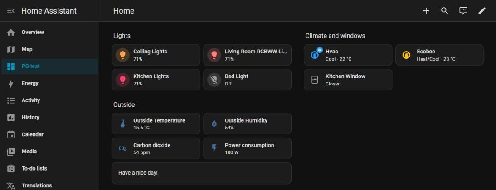
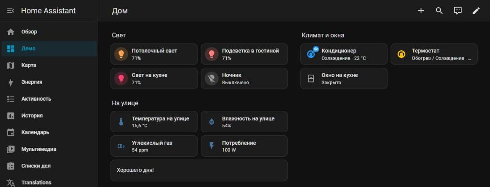
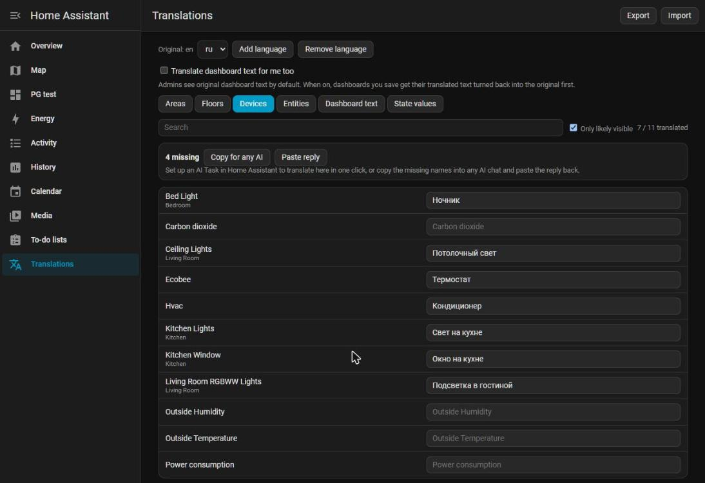

# Polyglot

Per-user names for Home Assistant. Everyone in the home sees area, floor, device, entity and dashboard names in
the language of their own HA profile, and falls back to the original name where no translation exists.

Home Assistant translates its own interface per user, but the names you type yourself (rooms, devices, card
titles) exist in one language only. Polyglot adds a translation layer on top, without renaming anything: your
automations, history and entity IDs stay exactly as they are.

The same dashboard for a user with English and one with Russian in their profile:




The Translations page, where an admin fills in the names:



## How it works

- **Translations page** (admin only, sidebar → Polyglot). One row per area, floor, device, entity and dashboard
  string, one input per row. Pick a language, type, press Enter. Export and import as JSON.
- **Use Home Assistant's names**: many entities are named by their integration, and Home Assistant already has
  those names in other languages; it just shows entity names in the system language. The Entities tab fills those
  in for you (as suggestions to review). It is also the first step of the AI and copy buttons, so the AI only gets
  the rest.
- **Translate missing with AI**: sends the untranslated names on the current tab to an AI Task set up in Home
  Assistant (Claude, OpenAI, Ollama or any other). Names go grouped by device, room or dashboard view, each
  repeated name once, with a short description: entity type, unit, range, the first few options and numeric
  values. An entity's current text state is not part of that description. The *State values* tab is different:
  there the state texts and options are what gets translated, so they are sent; use Search to narrow them down if
  some are private (an address, a caller's name). Your existing translations go along as a glossary, so the AI
  keeps your terms. Suggestions appear dashed for review and are saved only with *Save all* or by editing a field;
  clearing a suggestion drops it. Ones worth a second look (the AI was unsure, two different names got the same
  translation, or it is much longer than the original) are marked, with a filter to show only those.
- **Row filter**: show all rows, only the missing ones, only the suggestions waiting for review, or both.
- **Copy for any AI / Paste reply**: the same request as text for any AI chat or a human translator; paste the
  JSON reply back to get the same reviewable suggestions.
- **Overlay** that every page loads. For a user whose profile language has translations, it swaps the names in the
  frontend before any card sees them: dashboards, tiles, more-info dialogs, the sidebar, history and logbook.
- **Nothing is written back.** Translations live in `.storage/polyglot.translations`. Settings and developer tools
  pages always show the original names, so a translated name can never be saved by accident.

Original names are taken to be in the system language (Settings → System → General). A user whose profile
language matches it, or who has no translations, sees the original names.

## Requirements

Home Assistant 2026.3 or newer. Tested on 2026.3, 2026.6, 2026.9 and 2026.11, and with a right-to-left language
(Hebrew).

## Install

1. HACS → Custom repositories → add this repository as an *Integration*, then install Polyglot. Or copy
   `custom_components/polyglot` into your `config/custom_components`.
2. Restart Home Assistant.
3. Settings → Devices & services → Add integration → Polyglot.
4. Open **Polyglot** in the sidebar, add a language (the code from the HA profile, for example `ru`, `de`,
   `pt-BR`), and translate.
5. Each person picks their language in their profile (bottom left → Language).

Reload open browser tabs and the companion app after installing or upgrading.

An AI Task is optional: without one, use *Copy for any AI* or type the translations yourself.

## What gets translated

| | Translated |
|---|---|
| Area and floor names | Everywhere outside settings |
| Device names | Everywhere outside settings |
| Entity names | Everywhere outside settings. For entities named "device + entity", both parts are translated separately |
| Sidebar dashboard titles | Yes, through *Dashboard text* |
| State values | Through *State values*: text states and select options that the integration leaves untranslated ("Sweeping and mopping", "recirculation"). Values Home Assistant already translates into the chosen language are not listed |
| Dashboard text: view titles, headings, card names | For non-admin users, and for admins who turn on *Translate dashboard text for me too* on the Translations page (a per-person setting). An exact match of the whole string, so `Living room` is translated but `Living room temperature` needs its own row |

## Templates

Card templates (Markdown, Mushroom and other cards that render templates) get a `language` variable with the
viewer's profile language:

```jinja

{{ 'Добрый вечер' if ru else 'Good evening' }}
```

Use `language is defined` so the template still works where Polyglot is not loaded (the companion app before an
update, or the preview of a template helper).

## Limits

- Text built on the server stays in the original language: notifications, Assist voice replies, logbook messages
  written by automations and template sensors. Card templates can switch language themselves, see above.
- Settings, developer tools and your profile page always show original names. That is deliberate.
- Admins see untranslated dashboard text unless they opt in. When they do and save a dashboard, text that matches a
  translation is turned back into the original first; a translation shared by two originals is saved as typed.
- What a card's action sends to Home Assistant (`data`, `target`) is never translated.
- Taking control of a generated dashboard while names are translated saves the original names. A translated name
  shared by two different originals is saved as shown.
- Settings dialogs opened from a translated page (more-info → settings → device) get the original names, so saving
  them never stores a translation.
- Polyglot depends on Home Assistant frontend internals. If a release changes them, Polyglot switches itself off and
  everyone sees the original names until an update. Check the browser console for `[polyglot]` messages.

## Questions

**Nothing is translated.** Check, in this order:
- The person's profile language (bottom left → Language) is one of the languages added on the Polyglot page.
  `pt-BR` also uses a `pt` dictionary, and the other way round.
- It is not the system language. Names are taken to be written in that one, so those people see them as they are.
- The page is not Settings, Developer tools or the profile: those always show the original names.
- The browser tab or the companion app was reloaded after installing or upgrading.
- The browser console has no `[polyglot]` warning.

**Names are translated but headings and card titles are not.** You are an admin. Admins see the original dashboard
text unless they turn on *Translate dashboard text for me too* on the Polyglot page. Everyone else gets it
translated. Also, dashboard text is matched as a whole string: `Living room temperature` needs its own row.

**Does it rename anything?** No. Entity IDs, names in the registries, automations, scripts, history and voice
assistants all keep using the original names. Polyglot only changes what a browser or the companion app shows.

**Does Assist understand the translated names?** No. Assist, notifications and everything else that runs on the
server know only the original names. Use Home Assistant's aliases for names in other languages.

**Does it work in the companion app?** Yes, in the app's dashboards. Widgets, the watch app, Android Auto and
notifications are built outside the frontend and show the original names.

**Does it work with my custom cards?** With cards that take names from Home Assistant's `hass` object, which is
nearly all of them. A card that fetches names itself, or text typed into a config key Polyglot does not know
(it translates `name`, `title`, `heading`, `label`, `primary`, `secondary`, `content`, `text` and a few more),
stays as it is.

**YAML dashboards?** Entity, device and area names are translated on them like anywhere else. Their text is
translated too when the same string has a row, but the Polyglot page only lists text from dashboards stored in
the UI.

**I renamed an entity ID, or removed a device.** Translations are stored by ID. The old row moves to the top of its
tab, marked as no longer existing: copy its text to the new row, then clear it.

**Where are the translations, and are they backed up?** In `.storage/polyglot.translations`, part of every Home
Assistant backup. *Export* on the Polyglot page writes the same data as a JSON file.

**What happens when I disable or remove Polyglot?** Disabling it keeps the translations and everyone sees the
original names again. Removing the integration deletes them: export first if you may want them back.

**What does the AI get?** Only what you send with the AI buttons: the untranslated names on the open tab, a short
description of each (type, unit, range, first options, numeric value) and matching entries of your existing
translations. On the *State values* tab the state texts themselves. Nothing is sent on its own, and nothing is
saved before you review it.

**Is it slow?** No. People without a dictionary get the original objects untouched. For the others, names are
swapped once per change and unchanged entities keep the same objects, so cards do not redraw more often.

## Development

```
npm test                                # frontend logic, node --test
pip install -r requirements_test.txt    # Python 3.14
pytest                                  # integration: setup, storage, WebSocket API
ruff check . && ruff format --check .
```

CI runs all of these plus hassfest on every push, and the HACS check once the repository is public.

The frontend is plain ES modules served straight from `custom_components/polyglot/frontend`, no build step.
`core.js` holds the pure translation logic and is what the tests cover.

To check a change to the AI prompt, run it on a fixed set of hard names (`tools/ai-eval/cases.json`) through a
real AI Task. It writes a review sheet to `tools/ai-eval/out/` for a native speaker; `--judge` adds a second AI's
verdict as a rough signal (judges make mistakes too).

```
HA_URL=https://ha.example HA_TOKEN=... node tools/ai-eval/run.mjs --to ru --entity ai_task.x [--judge ai_task.y]
```

## License

MIT
